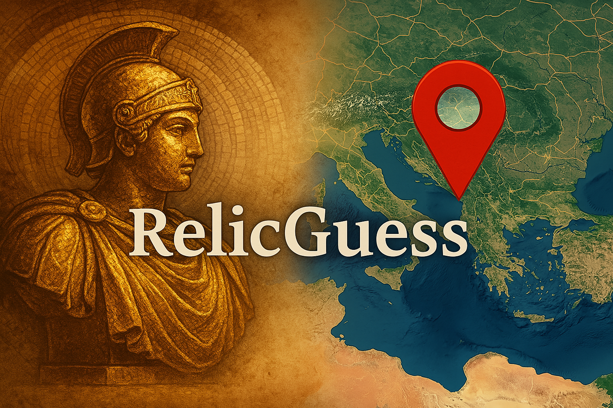

# Relic

A geography game for people who like history. You get a photograph of an ancient
object; you drop a pin where you think it came from; the game shows you where it
actually came from, how far off you were, and what the thing is.



## Quick start

```bash
npm install
npm run dev          # http://localhost:5173
```

> **On a mounted Windows filesystem** (`/mnt/c/...` under WSL2) the dev server
> polls for changes, because inotify events never arrive there and Vite would
> otherwise keep serving a cached transform of a file you just edited — HMR appears
> to work while the browser runs stale code. Set `VITE_NO_POLLING=1` on a native
> Linux or macOS checkout to get the cheaper event-based watcher back. Expect the
> first page load to be slow on this filesystem; subsequent ones are fast.

The artifact collection is committed at `public/data/artifacts.json`, so the game
runs immediately without an ingest.

```bash
npm run verify       # format check → lint → typecheck → unit tests → production build
npm run test:e2e     # Playwright, eight viewports (needs: npx playwright install chromium)
npm run test:e2e:dev # the same specs against the dev server instead of the bundle
```

## How the game works

**Five rounds.** Each shows one artifact photograph and a world map. Tap or click the
map to place a pin, drag it to adjust, then lock it in. You get up to 5,000 points a
round, decaying continuously with distance — a near miss and a bullseye are not the
same, and neither are 199 km and 201 km.

**Difficulty changes what you are told, not how hard the controls are.**

|              | Shown before you guess                                                |
| ------------ | --------------------------------------------------------------------- |
| **Explorer** | Object type, era, date, culture, material — and only well-known finds |
| **Scholar**  | Object type, era, material                                            |
| **Expert**   | Object type. Anything in the collection.                              |

Nothing shown before a guess ever names a place. Everything else — the origin, the
culture, the date, the excavation, the museum, the source record — comes after.

**Also included:** a daily challenge (same five artifacts for everyone, seeded by the
date), region and period filters, streaks, per-difficulty personal bests, and a
spoiler-free shareable result.

### Scoring

```
effective = max(0, distance − uncertainty)
score     = 5000 · e^(−effective / 1500 km)
```

`uncertainty` is how precisely the _source_ records the origin. A dig site is known
to ~15 km; "Mesopotamia" is a region hundreds of km across. Guessing inside that
radius scores full marks, because it is as close as the data can distinguish, and the
reveal says so in words and draws the radius on the map.

See [docs/GEO_CONFIDENCE.md](docs/GEO_CONFIDENCE.md) for why this matters and how the
tiers are derived.

## Where the artifacts come from

1,700+ objects from four open collections, geocoded through the Pleiades gazetteer of
ancient places:

| Source                                                                                                       | Licence                                               |
| ------------------------------------------------------------------------------------------------------------ | ----------------------------------------------------- |
| [Wikidata](https://www.wikidata.org/) & Wikimedia Commons                                                    | CC0 metadata; **images licensed per file**            |
| [The Cleveland Museum of Art](https://openaccess-api.clevelandart.org/)                                      | CC0                                                   |
| [Art Institute of Chicago](https://api.artic.edu/docs/)                                                      | CC0, **except `description` text which is CC BY 4.0** |
| [The Metropolitan Museum of Art](https://www.metmuseum.org/about-the-met/policies-and-documents/open-access) | CC0                                                   |
| [Pleiades](https://pleiades.stoa.org/) (place coordinates)                                                   | **CC BY 3.0 — attribution required**                  |
| Basemap                                                                                                      | © OpenStreetMap contributors (ODbL)                   |

Relic is **not affiliated with or endorsed by any of these institutions.**

The hard part is not fetching the data, it is deciding _which_ location a round should
ask for. Museum records routinely attach three or more non-equivalent places to one
object — where it was made, where it was excavated, and where it is displayed today —
and the game must never ask a player to find a museum in Manhattan for an Egyptian
statue. [docs/DATA_SOURCES.md](docs/DATA_SOURCES.md) compares 20 candidate sources and
records what was integrated, what was rejected, and why.

### Rebuilding the collection

```bash
export INGEST_CONTACT="you@example.com"   # required by Wikimedia's User-Agent policy
npm run ingest                            # ~5.8 MB bundle, ~3,500 artifacts
npm run ingest -- --dry                   # report only
npm run ingest -- --provider=cma --limit=300
```

Responses are cached under `.cache/`, so re-running to adjust normalisation is cheap
and does not re-hammer the providers. The run prints rejections by reason and the
distribution across provider, coordinate tier, region and era — watch those numbers
after touching an adapter.

## Documentation

- [docs/ARCHITECTURE.md](docs/ARCHITECTURE.md) — structure, and the reasoning behind
  each technical choice
- [docs/DATA_SOURCES.md](docs/DATA_SOURCES.md) — source comparison, licensing
  obligations, map-tile terms
- [docs/GEO_CONFIDENCE.md](docs/GEO_CONFIDENCE.md) — coordinate tiers, scoring
  tolerance, per-provider hazards

## Accessibility

Keyboard-playable end to end: the map is focusable, arrows pan, `+`/`-` zoom, Enter
places the pin at the viewport centre and then advances the round. The guess and
origin markers differ in shape, fill and glyph as well as colour. Score changes are
announced as a single sentence rather than five loose numbers, focus moves to the
result on reveal, motion respects `prefers-reduced-motion`, and interactive targets
are at least 44px on their short axis.

## Stack

Vite · React 19 · TypeScript · Tailwind v4 · Leaflet · zustand · framer-motion ·
Vitest · Playwright. No backend, no API keys, no database.
